# Genuine application screenshots

Captured locally on 28 October 2026 using a real PostgreSQL database and a real public GitHub scan. The sample is `gothinkster/node-express-realworld-example-app`, commit `30b68e1e881462b2f4164ea09ab4c4f5699c7b0b`. No imported code was executed. Figures are actual static scan output, not customer metrics.

[Open the local HTML gallery](SCREENSHOTS.html)

## Landing page

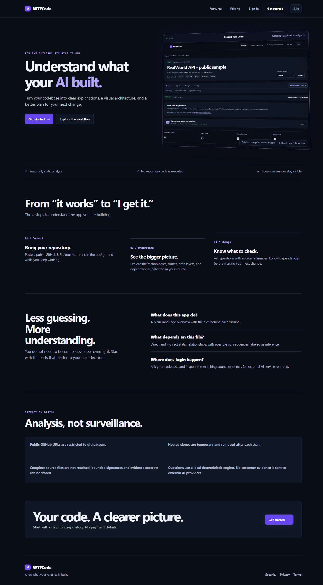

## Projects dashboard

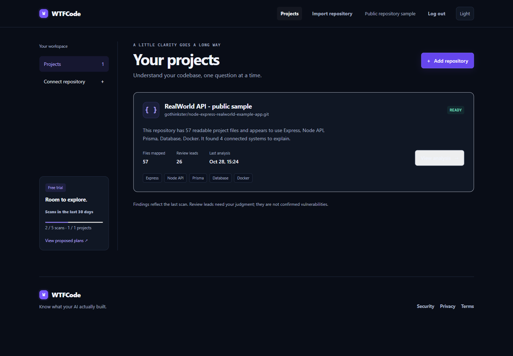

## Light theme

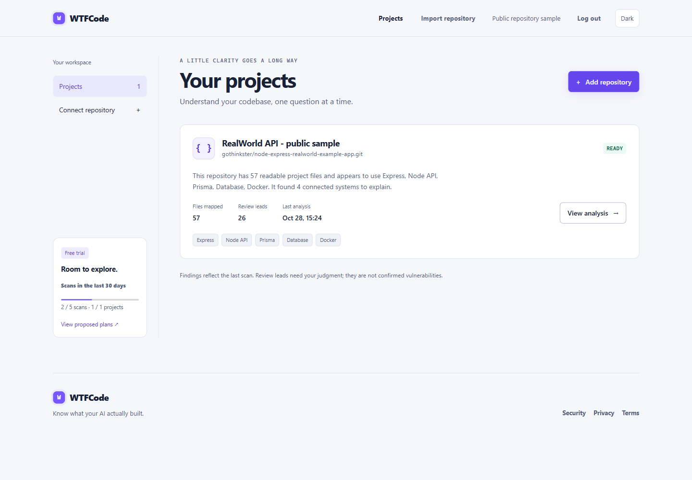

## Empty workspace

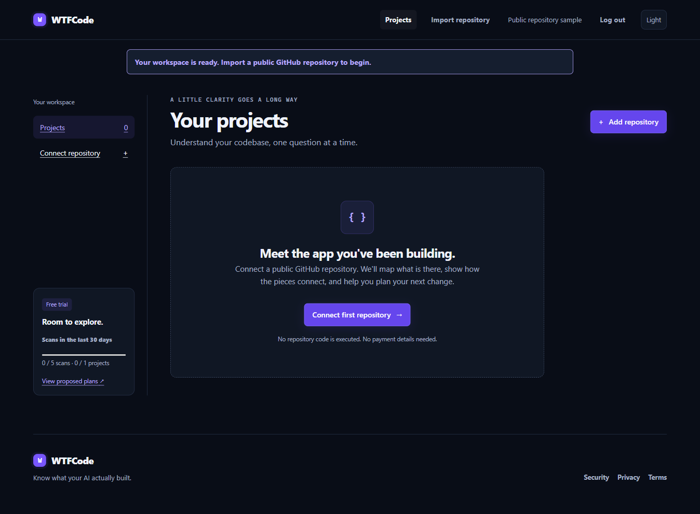

## Repository import

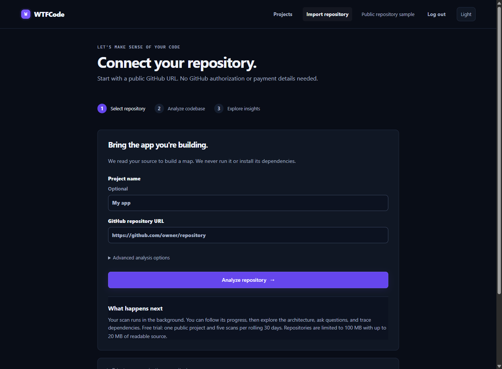

## Project analysis

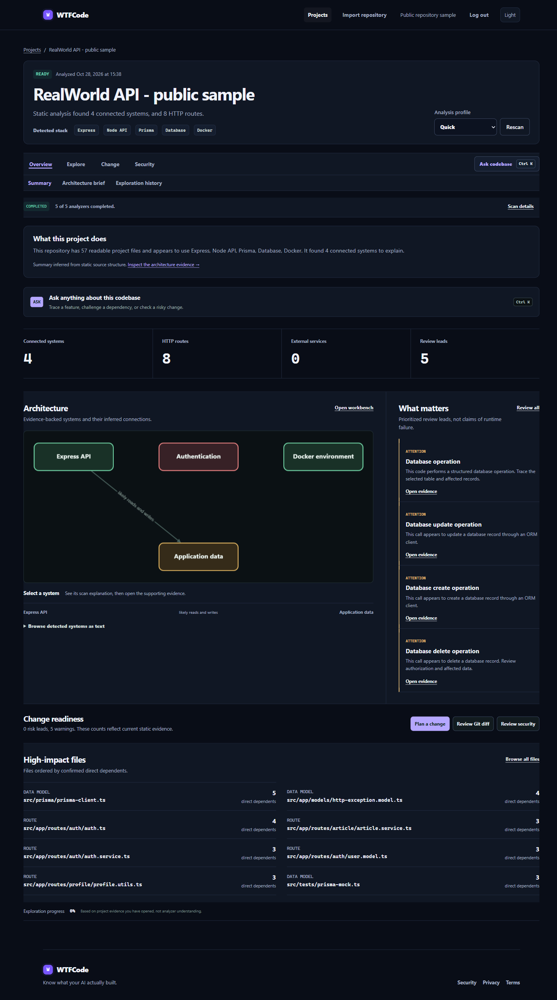

## Dependency visualization

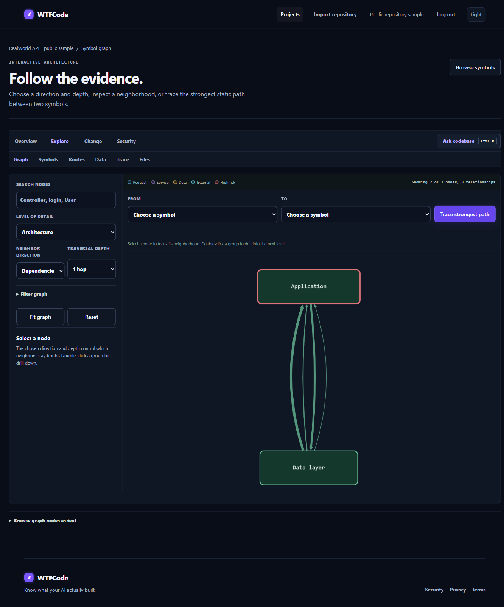

## Change impact

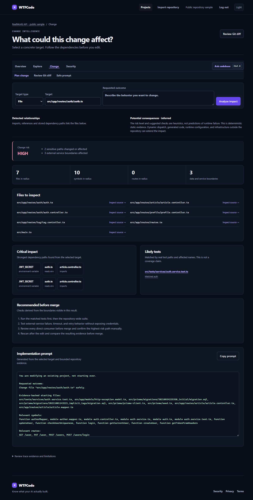

## Source-backed questions

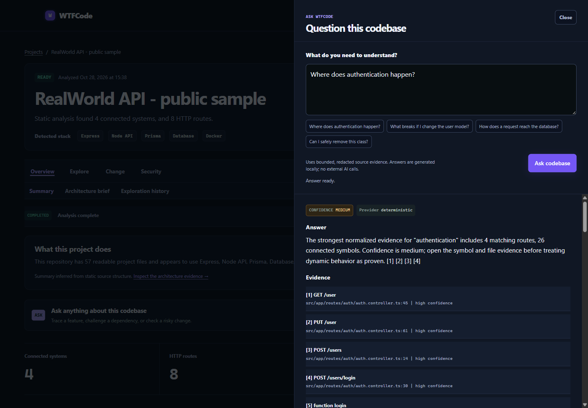

## Source inspection

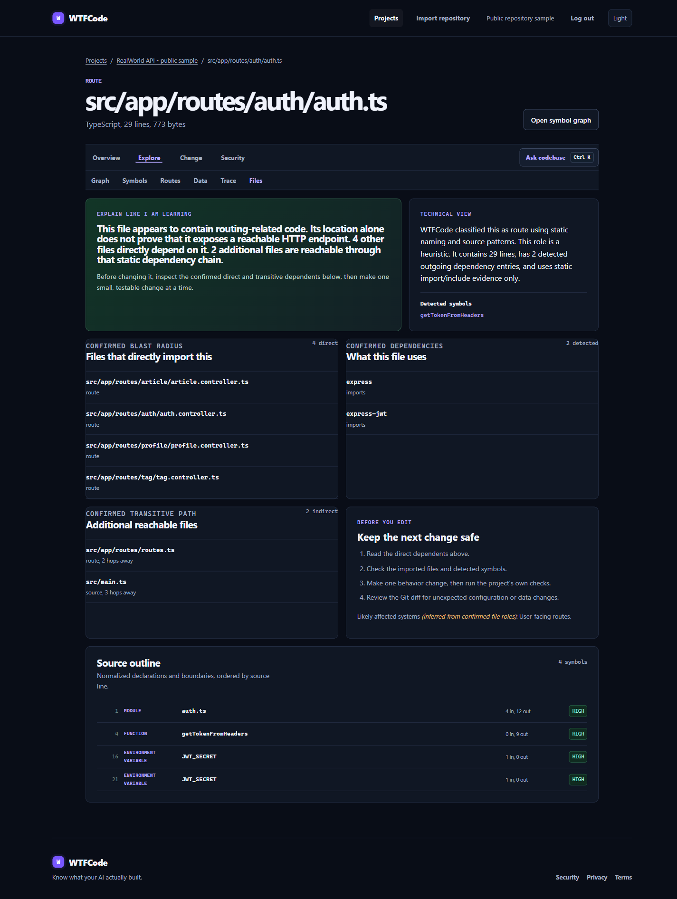

## Proposed pricing

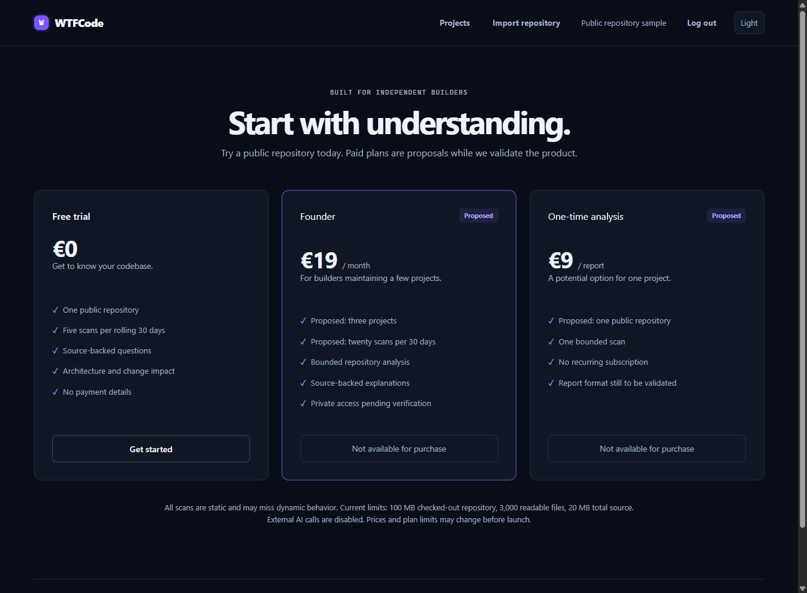

## Mobile project view

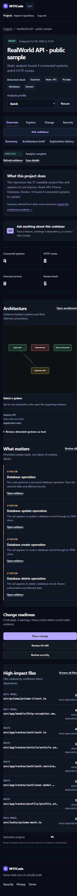

## Mobile change impact

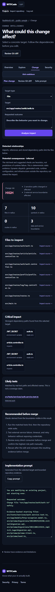

## Import validation error

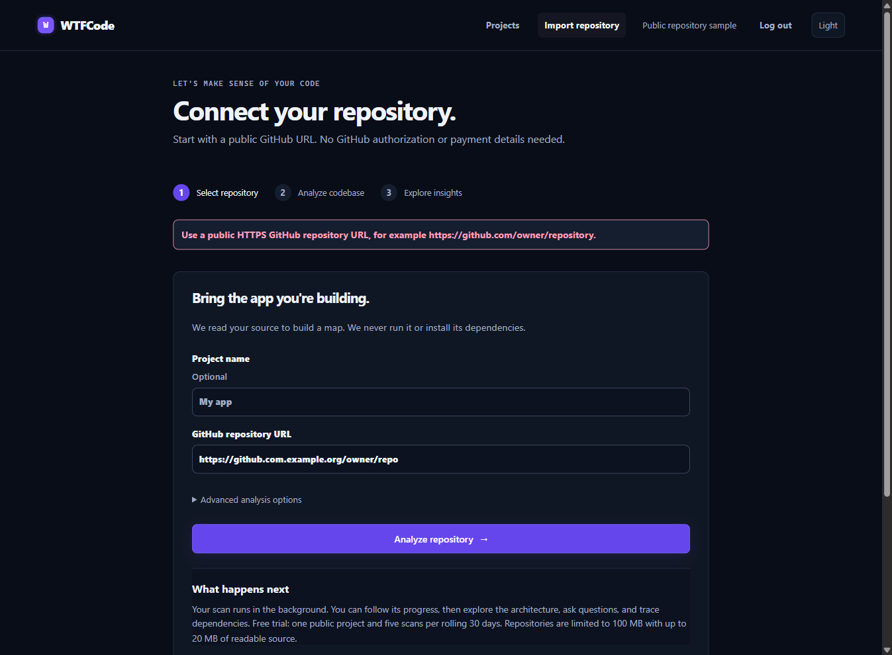
