# WTFCode UX 2.0 — before and after

All images are genuine browser captures. The original 14 baseline images are unchanged. The public sample repository and commit are the same; the after set uses a fresh local database. Open an image to inspect it at full resolution.

[Scrollable HTML gallery](UX-V2-COMPARISON.html) · [All 23 new screenshots](UX-V2-SCREENSHOTS.md) · [Implementation and verification](UX-V2-REPORT.md)

| Before · SaaS MVP | After · UX 2.0 |
| --- | --- |
|  | <a href="screenshots-v2/05-project-overview.png">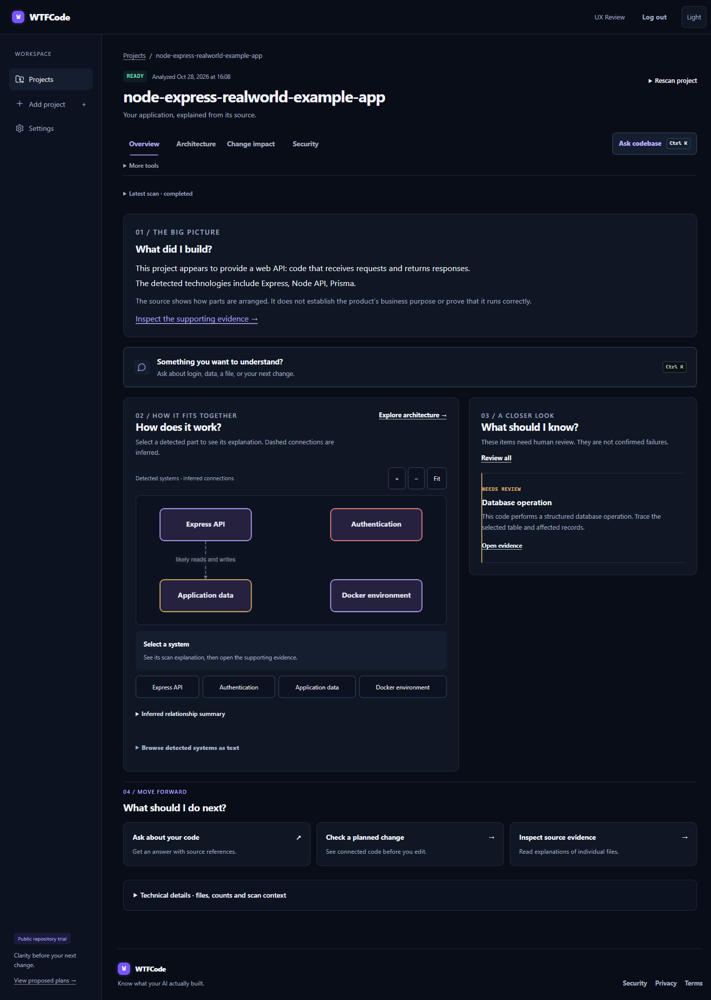</a> |
|  | <a href="screenshots-v2/08-ask-codebase.png">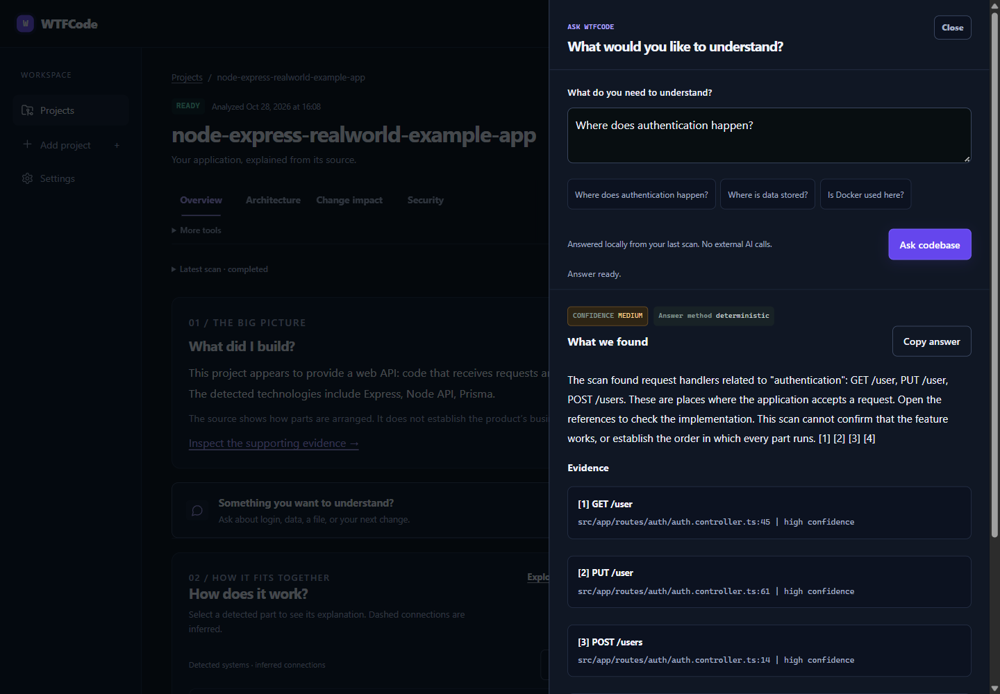</a> |
|  | <a href="screenshots-v2/10-change-result.png">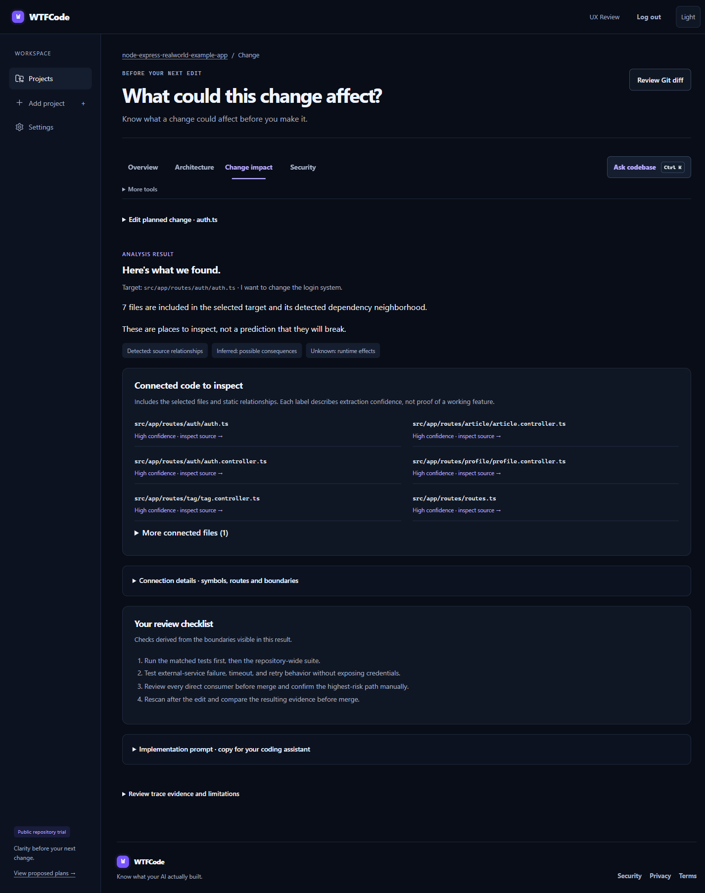</a> |
|  | <a href="screenshots-v2/07-dependency-graph.png">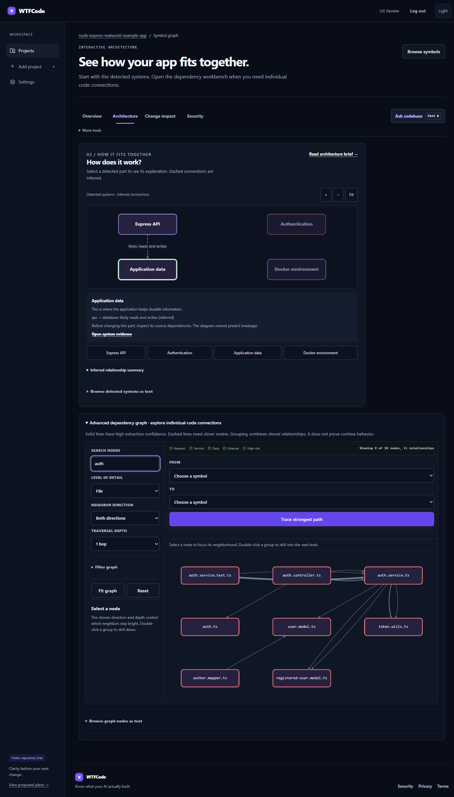</a> |
|  | <a href="screenshots-v2/23-dashboard-hover.png">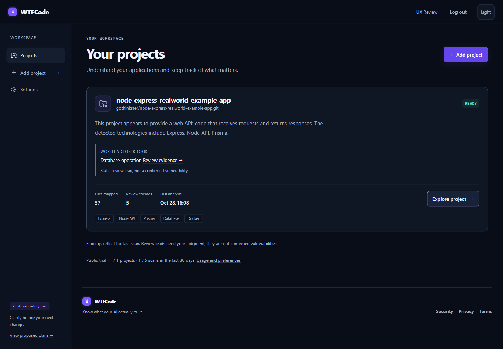</a> |
|  | <a href="screenshots-v2/02-empty-dashboard.png">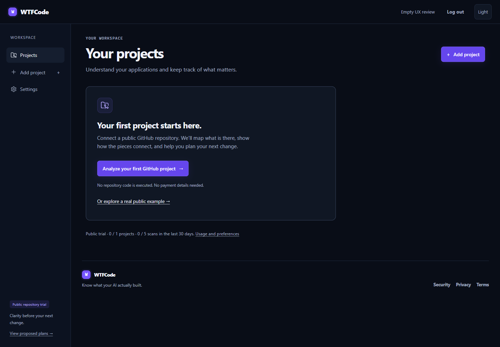</a> |
|  | <a href="screenshots-v2/11-source-explanation.png">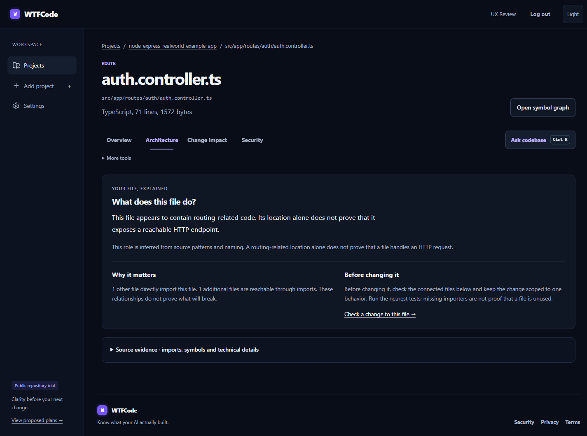</a> |
|  | <a href="screenshots-v2/01-landing.png">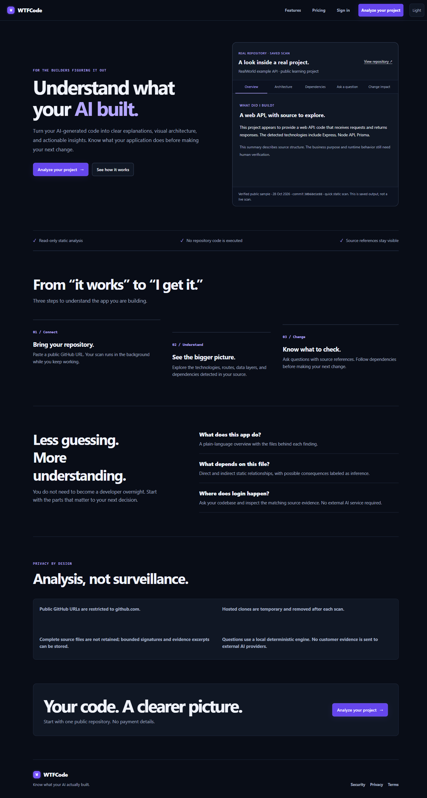</a> |
|  | <a href="screenshots-v2/12-pricing.png">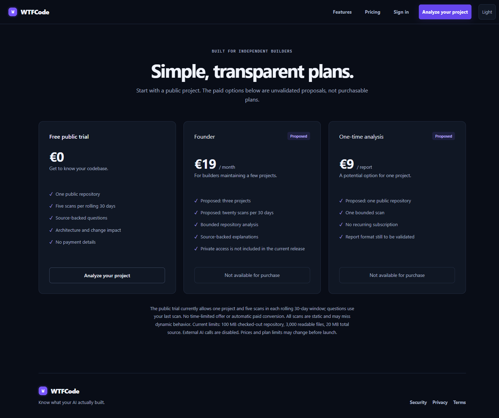</a> |
|  | <a href="screenshots-v2/22-light-dashboard.png">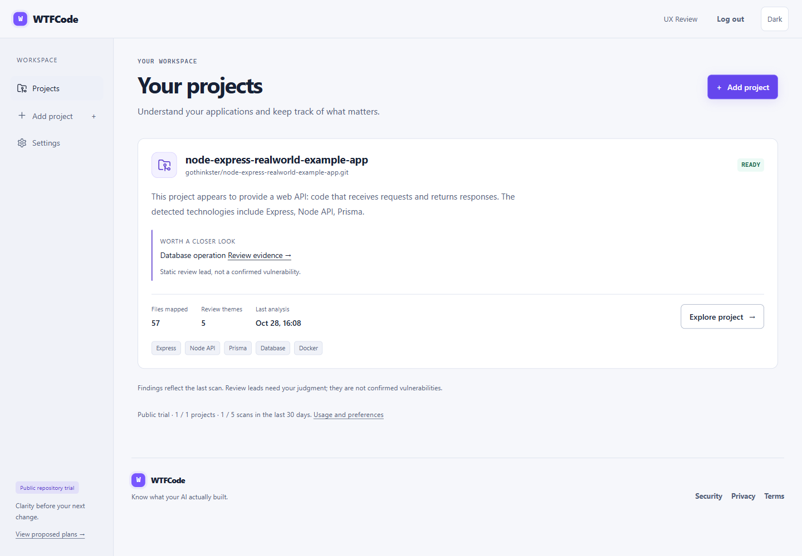</a> |
|  | <a href="screenshots-v2/15-mobile-project.png">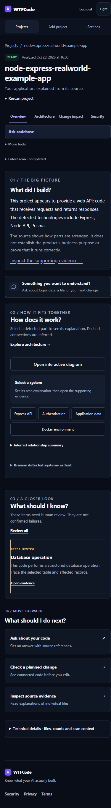</a> |
|  | <a href="screenshots-v2/16-mobile-change.png">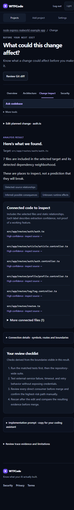</a> |
|  | <a href="screenshots-v2/04-repository-import.png">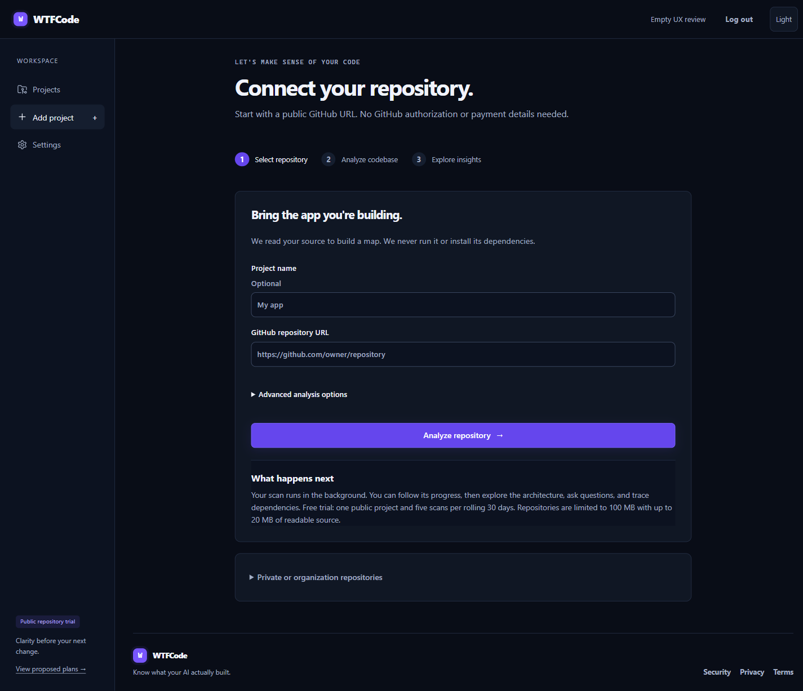</a> |
|  | <a href="screenshots-v2/18-import-error.png">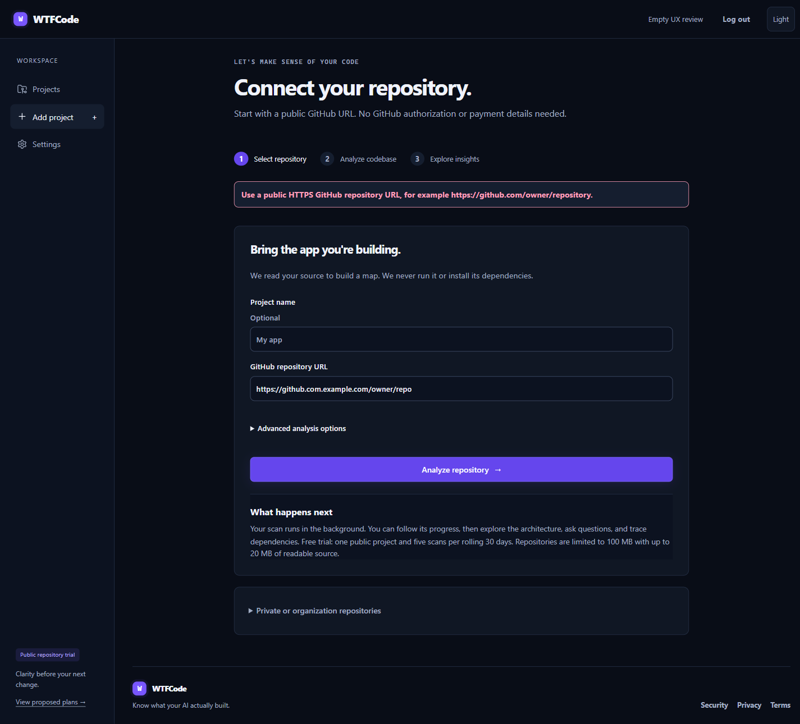</a> |
